<picture>
  <source media="(prefers-color-scheme: dark)" srcset="assets/banner-dark.svg">
  <source media="(prefers-color-scheme: light)" srcset="assets/banner-light.svg">
  
</picture>

---

## 💫 About Me

- 🔭 Currently building **AI-powered web apps** with React & TypeScript
- 🎓 Studying Computer Science (B.E./B.Tech, Batch 2028) — Semester 5
- 🧠 Practising **DSA** regularly on LeetCode (sorting, string searching, and more)
- 🛠️ Exploring **Python packaging**, **Java**, and **C systems programming**
- 🌱 Learning: AI agents, system design, cloud
- 📫 Reach me on GitHub: [@B-Praveen18](https://github.com/B-Praveen18)

---

## 🚧 Featured Projects

Hanging on the rail — click a board to open its live demo, or use the links underneath.

<table align="center">
  <tr>
    <td align="center" valign="top" width="20%">
       
      <b>Air-Aware</b> 
      Air-pollution awareness with an AI guide 
      <a href="https://github.com/B-Praveen18/Air-Aware">📂 GitHub Repo</a> <a href="https://air-aware-tau.vercel.app">🚀 Live Demo</a>
    </td>
    <td align="center" valign="top" width="20%">
       
      <b>Business-Growth-OS</b> 
      AI business growth, six response agents 
      <a href="https://github.com/B-Praveen18/Business-Growth-OS">📂 GitHub Repo</a> <a href="https://business-growth-os-v26v-lac.vercel.app">🚀 Live Demo</a>
    </td>
    <td align="center" valign="top" width="20%">
       
      <b>Praveen-B-Portfolio</b> 
      My personal developer portfolio 
      <a href="https://github.com/B-Praveen18/Praveen-B-Portfolio">📂 GitHub Repo</a> <a href="https://praveen-b-folio.vercel.app">🚀 Live Demo</a>
    </td>
    <td align="center" valign="top" width="20%">
       
      <b>Somnus AI</b> 
      AI sleep-stage monitor &amp; smart wake system (ESP32 + ML) 
      <a href="https://github.com/B-Praveen18/Somnus">📂 GitHub Repo</a> <a href="https://somnus-ai.vercel.app/">🚀 Live Demo</a>
    </td>
    <td align="center" valign="top" width="20%">
       
      <b>Automated Audio Minutes</b> 
      Audio to meeting minutes, automated 
      🔒 Private repo <a href="https://automated-audio-minutes-system-5fiw.vercel.app/">🚀 Live Demo</a>
    </td>
  </tr>
</table>

---|---|---|---|---|---|
| **[Air-Aware](https://github.com/B-Praveen18/Air-Aware)** | Interactive web app promoting air-pollution awareness with AI-powered insights |   |  | [🚀 Live Demo](https://air-aware-tau.vercel.app) | [Repo](https://github.com/B-Praveen18/Air-Aware) |
| **[Business-Growth-OS](https://github.com/B-Praveen18/Business-Growth-OS)** | AI-powered business growth platform with six AI response agents |   |  | [🚀 Live Demo](https://business-growth-os-v26v-lac.vercel.app) | [Repo](https://github.com/B-Praveen18/Business-Growth-OS) |
| **[Praveen-B-Portfolio](https://github.com/B-Praveen18/Praveen-B-Portfolio)** | Personal portfolio showcasing my projects, skills and interests |  |  | [🚀 Live Demo](https://praveen-b-folio.vercel.app) | [Repo](https://github.com/B-Praveen18/Praveen-B-Portfolio) |
| **Automated Audio Minutes System** | Automated audio transcription and meeting-minutes generator |  | — | [🚀 Live Demo](https://automated-audio-minutes-system-5fiw.vercel.app/) | 🔒 Private |

---

## 📚 Academics & Practice

| Area | Repository | Stars |
|---|---|---|
| 🧮 Data Structures & Algorithms | [Leet-Code](https://github.com/B-Praveen18/Leet-Code) · [Sorting-Technique](https://github.com/B-Praveen18/Sorting-Technique) · [String-searching-techniques](https://github.com/B-Praveen18/String-searching-techniques) |  |
| 🖥️ Operating Systems (C) | [Operating-System](https://github.com/B-Praveen18/Operating-System) |  |
| 🌐 Computer Networks (C) | [COMPUTERNETWORKS](https://github.com/B-Praveen18/COMPUTERNETWORKS) |  |
| 🗄️ Database Management | [DATA-BASE-MANAGEMENT-SYSTEM](https://github.com/B-Praveen18/DATA-BASE-MANAGEMENT-SYSTEM) |  |
| ⚙️ Compiler Design (Lex) | [compiler-design-lab](https://github.com/B-Praveen18/compiler-design-lab) |  |
| 🎨 Web Design | [Web-Design](https://github.com/B-Praveen18/Web-Design) |  |

---

## 🛠️ Tech Stack

---

## 📊 GitHub Stats

---

⭐ If you like my work, drop a star on a repo — thanks for visiting!

