<picture>
  <source media="(prefers-color-scheme: dark)" srcset="assets/banner-dark-v2.svg">
  <source media="(prefers-color-scheme: light)" srcset="assets/banner-light-v2.svg">
  
</picture>

<a href="https://praveen-b-folio.vercel.app">Portfolio</a> &nbsp;·&nbsp;
<a href="https://www.linkedin.com/in/praveenb1818">LinkedIn</a> &nbsp;·&nbsp;
<a href="https://github.com/B-Praveen18?tab=repositories">All repositories</a>

 

Computer Science undergraduate at Mepco Schlenk Engineering College, Sivakasi.

- I build full-stack web applications with React and TypeScript, with a focus on AI-powered features.
- On **Somnus**, an ECG-based sleep-stage monitoring and smart wake system, I worked on the machine-learning pipeline and backend APIs.
- I have a solid grounding in core computer science: operating systems, databases, computer networks and compiler design.
- Currently learning AI agents, system design and cloud infrastructure.

## Featured Projects

<table align="center">
  <tr>
    <td align="center" valign="top" width="20%">
       
      <b>Air-Aware</b> 
      Air-pollution awareness site with an AI guide 
      <a href="https://air-aware-tau.vercel.app">Live demo</a> · <a href="https://github.com/B-Praveen18/Air-Aware">Code</a>
    </td>
    <td align="center" valign="top" width="20%">
       
      <b>Business-Growth-OS</b> 
      Business growth platform with six AI agents 
      <a href="https://business-growth-os-v26v-lac.vercel.app">Live demo</a> · <a href="https://github.com/B-Praveen18/Business-Growth-OS">Code</a>
    </td>
    <td align="center" valign="top" width="20%">
       
      <b>Portfolio</b> 
      Personal developer portfolio 
      <a href="https://praveen-b-folio.vercel.app">Live demo</a> · <a href="https://github.com/B-Praveen18/Praveen-B-Portfolio">Code</a>
    </td>
    <td align="center" valign="top" width="20%">
       
      <b>Somnus AI</b> 
      Sleep-stage monitoring and smart wake system (ESP32, ML) 
      <a href="https://somnus-ai.vercel.app/">Live demo</a> · <a href="https://github.com/B-Praveen18/Somnus">Code</a>
    </td>
    <td align="center" valign="top" width="20%">
       
      <b>Audio Minutes</b> 
      Turns meeting audio into written minutes 
      <a href="https://automated-audio-minutes-system-5fiw.vercel.app/">Live demo</a> · Code private
    </td>
  </tr>
</table>

## Coursework & Practice

| Area | Repositories |
|---|---|
| Data structures & algorithms | [Leet-Code](https://github.com/B-Praveen18/Leet-Code), [Sorting-Technique](https://github.com/B-Praveen18/Sorting-Technique), [String-searching-techniques](https://github.com/B-Praveen18/String-searching-techniques) |
| Operating systems (C) | [Operating-System](https://github.com/B-Praveen18/Operating-System) |
| Computer networks (C) | [COMPUTERNETWORKS](https://github.com/B-Praveen18/COMPUTERNETWORKS) |
| Database management | [DATA-BASE-MANAGEMENT-SYSTEM](https://github.com/B-Praveen18/DATA-BASE-MANAGEMENT-SYSTEM) |
| Compiler design (Lex) | [compiler-design-lab](https://github.com/B-Praveen18/compiler-design-lab) |
| Web design | [Web-Design](https://github.com/B-Praveen18/Web-Design) |

## Skills

| | |
|---|---|
| **Languages** | C, Java, Python, TypeScript, SQL |
| **Frontend** | React, HTML, CSS, Tailwind CSS |
| **Backend & ML** | FastAPI, XGBoost, ONNX |
| **Tools** | Git, Docker, Vercel, VS Code |
